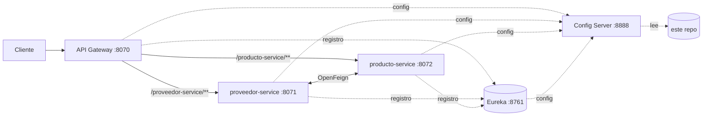

# Config Repo · Microservicios Spring Cloud

Repositorio de **configuración centralizada** para una arquitectura de microservicios con **Spring Cloud**. Es el caso de una empresa retail que migra su sistema monolítico. El **Config Server** lee de aquí la configuración de cada servicio al arrancar.

## Arquitectura



| Servicio | Puerto | Archivo de configuración |
|---|---|---|
| Discovery Server (Eureka) | 8761 | `discovery-server-i202403579.properties` |
| API Gateway (Gateway MVC) | 8070 | `api-gateway-i202403579.properties` |
| Proveedor Service | 8071 | `proveedor-service-i202403579.properties` |
| Producto Service | 8072 | `producto-service-i202403579.properties` |
| Config Server | 8888 | (lee este repositorio) |

Los servicios de proveedores y productos se comunican entre sí con **OpenFeign**. El Gateway enruta a cada uno usando `lb://` (balanceo con Eureka) y quita el prefijo de la ruta con `StripPrefix`.

## Cómo se usa

En el Config Server:

```properties
spring.cloud.config.server.git.uri=https://github.com/briansaa/briansaa-config-repo-i202403579
spring.cloud.config.server.git.default-label=master
```

En cada microservicio:

```properties
spring.application.name=producto-service-i202403579
spring.config.import=optional:configserver:http://localhost:8888
```

El nombre del archivo debe coincidir con `spring.application.name`. Antes toda la configuración estaba en un solo `.txt`, que el Config Server no puede servir.

**Orden de arranque:** Config Server → Eureka → API Gateway → proveedor-service → producto-service.

## Stack

Java · Spring Boot · Spring Cloud Config · Netflix Eureka · Spring Cloud Gateway MVC · OpenFeign

## Autor

**[Brian Saavedra](https://github.com/briansaa)**. Laboratorio de Desarrollo de Aplicaciones Web II, CIBERTEC.
